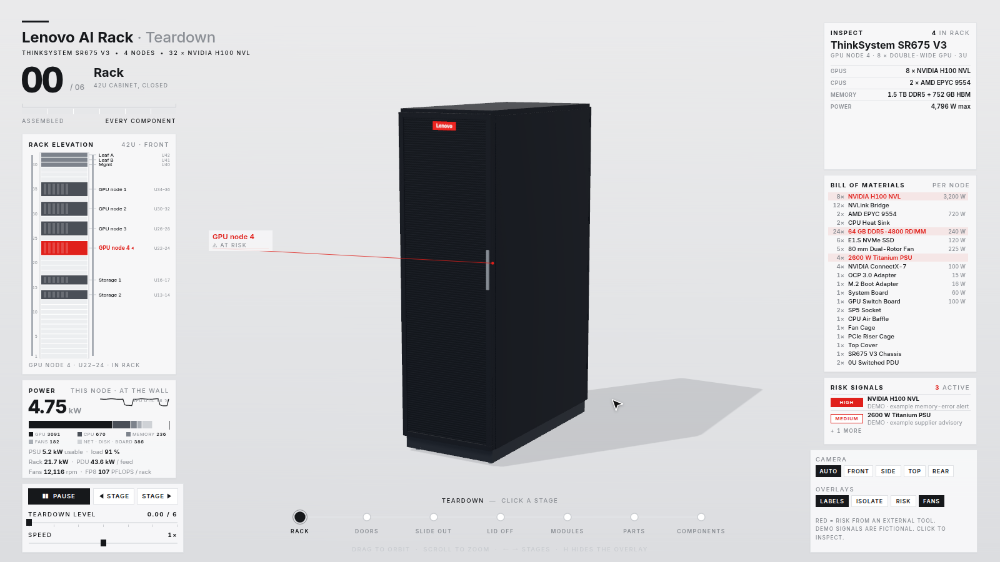
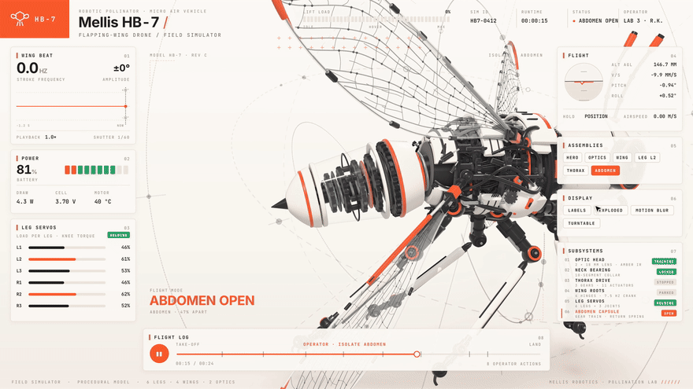
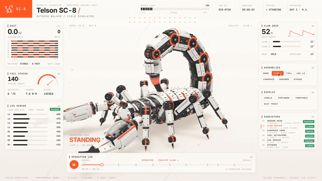
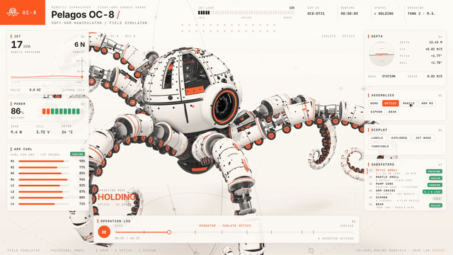

# teardown

A Claude Code skill that turns any machine into a 3D simulator you can take apart.

Ask how something works. Claude builds it as one offline HTML page: the machine runs in the middle, every panel around it reads the real numbers, a button opens the part doing the work, and when nobody touches it the page tours itself.

## Featured: Lenovo AI rack teardown

**[▶ Open the live, interactive Lenovo server rack demo](https://yorkerhodes3.github.io/teardown-3D/)**

[](https://yorkerhodes3.github.io/teardown-3D/)

A 42U Lenovo AI rack that explodes from the closed cabinet down to individual GPUs, CPUs, memory, fans, and power supplies. The BOM is swappable, and external risk signals highlight affected parts in red. [Explore the code and BOM](sims/lenovo-shared/bom.js).

- **Rack dashboard:** open the collapsible panel in the top-right to hide/show risk signals, edit branding and component quantities/SKUs, or import/export a BOM. Uploads accept only validated `teardown-bom` v1 `.json` files (max 256 KiB); export a template from the dashboard. Applying reloads the scene and keeps changes in this browser tab, without changing the published default. [Dashboard, approved file format, and vendor guide](docs/lenovo-dashboard.md).
- **Rack row and presets:** choose **View rack row** to see four adjacent cabinets and select one for a detailed teardown. The dashboard also offers illustrative Lenovo, Dell, HPE and Supermicro rack BOMs; select a preset, review it, and apply. These are examples, not certified order BOMs. See [sources and preset limitations](docs/lenovo-dashboard.md#illustrative-rack-presets).
- **Mobile:** on smaller screens, touch-friendly stage controls, part selection, inspection details, risk and fan toggles replace the compact desktop console.
- **Vendor flexibility:** text badges and same-shape SKU swaps are data-driven. Lenovo, Supermicro, Dell, HPE, ASUS, and GIGABYTE builds can use AMD/NVIDIA components, but different mechanical architectures require new geometry. The final scene is procedural Three.js geometry with canvas-drawn labels and HTML/CSS controls, not vendor CAD.
- **Tour:** the live demo is an interactive JavaScript/Three.js page, not a pre-recorded video. Its auto-tour is a sequence of timed actions in `sims/lenovo-shared/film.js` (`SCRIPT`): changing teardown stages, selecting parts, and showing risk. Edit those events and rebuild to change the tour. Interacting with the page takes control; the tour resumes after inactivity.
- **Fan switch:** the `FANS` overlay switch starts or stops the rendered rotor animation. It does not simulate airflow, cooling, or an electrical on/off state; fan power in the rack budget is a separate estimate.
- **Video:** the same scripted tour can be rendered to a video file with `sims/capture.mjs`; that exported file is a recording, unlike the live page.

> Not affiliated with or endorsed by Lenovo, NVIDIA, or AMD. Product names are their owners’ trademarks; dimensions, specifications, and wattages are illustrative. Default risk signals are fictional demo data.



| Telson SC-8 robotic scorpion | Pelagos OC-8 robotic octopus |
|---|---|
|  |  |

## Install

```
npx skills add elvarofficial/teardown -g -a claude-code
```

Then, once, in the installed folder:

```
npm install && npx playwright install chromium
```

You need Node.js 20 or newer. For the video you also need `ffmpeg`, and for the sound Python 3.

## Use

Ask Claude Code in plain words:

> Build me a simulator of a 4-stroke motorcycle engine I can take apart.

> How does a mechanical watch keep time? Show me as a simulator.

> Make a teardown of a hydraulic excavator arm and record a 20-second video of it.

Or open one of the 4 examples first:

```
node sims/build.mjs v8-live          # teardown-out/dist/v8-live.html
node sims/build.mjs cessna-live
node sims/build.mjs strandbeest-live
node sims/build.mjs lenovo-live      # a Lenovo AI rack, BOM-driven, with risk highlighting
```

## What is inside

| | |
|---|---|
| `SKILL.md` | What Claude reads: how a machine is built, the rules that make it look right, the review loop. |
| `sims/kit/` | Runtime, stage, shader warm-up. |
| `sims/v8-*`, `sims/cessna-*`, `sims/strandbeest-*`, `sims/lenovo-*` | 4 complete machines. `-shared` is the machine, `-live` the page you drive, `-film` the recorded tour. |
| `sims/build.mjs` | Bundles a machine into one HTML file, three.js and fonts inlined. |
| `sims/capture.mjs` | Renders the film frame by frame to a 60 fps mp4, or to review sheets of stills. |
| `sfx/`, `run_sfx.py` | Procedural sound on the film's timeline, mastered to −14 LUFS. |

## Lenovo AI rack: your BOM, your risk signals

`sims/lenovo-*` tears a 42U rack of ThinkSystem SR675 V3 GPU servers down in six stages, from the closed rack to every DIMM, GPU, fan and PSU on the bench.

- **Bill of materials.** Every part, count, dimension and wattage comes from `sims/lenovo-shared/bom.js`. Change it to match an order and rebuild. Layout, explode moves, BOM panel and power budget all follow. If a BOM doesn't fit (overlapping U, too many GPUs for the chassis), the build prints a `[bom]` warning.
- **Risk signals.** Any part can be painted red by an external tool. Pass a JSON array of `{match, level, reason, source}` with `?risk=<base64url>` or `?riskUrl=<url>` (polled), with `postMessage({type: 'teardown-risk', signals})`, or with `window.TEARDOWN.setRisk([...])`. `match` is a node id (`gpu-3`), a SKU (`psu.2600-ti`), a kind (`kind:fan`) or rack units (`U22-24`). The format is documented at the top of `sims/lenovo-shared/risk.js`.

> Not affiliated with or endorsed by Lenovo, NVIDIA or AMD; product names are their owners' trademarks. Dimensions, specs and wattages are illustrative, not official. The risk signals shown by default are fictional demo data, not findings about any real product, lot or supplier.

## Credits

Built on [whaleyxbt/claude-motion](https://github.com/whaleyxbt/claude-motion) (MIT): the runtime, frame capture, sound engine and review rules come from there. Recorded samples are CC0 from Freesound, prepared by [Barty-Bart/motion-graphics](https://github.com/Barty-Bart/motion-graphics); sources in `sfx/samples/SOURCES.md`.

MIT licence.
